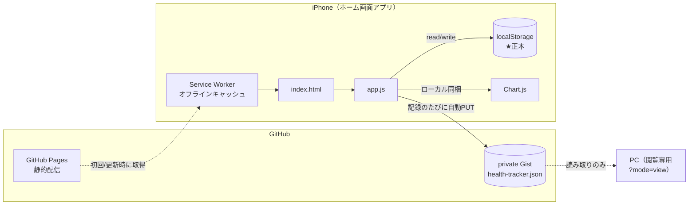
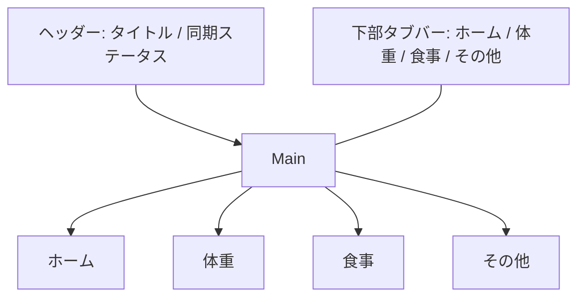
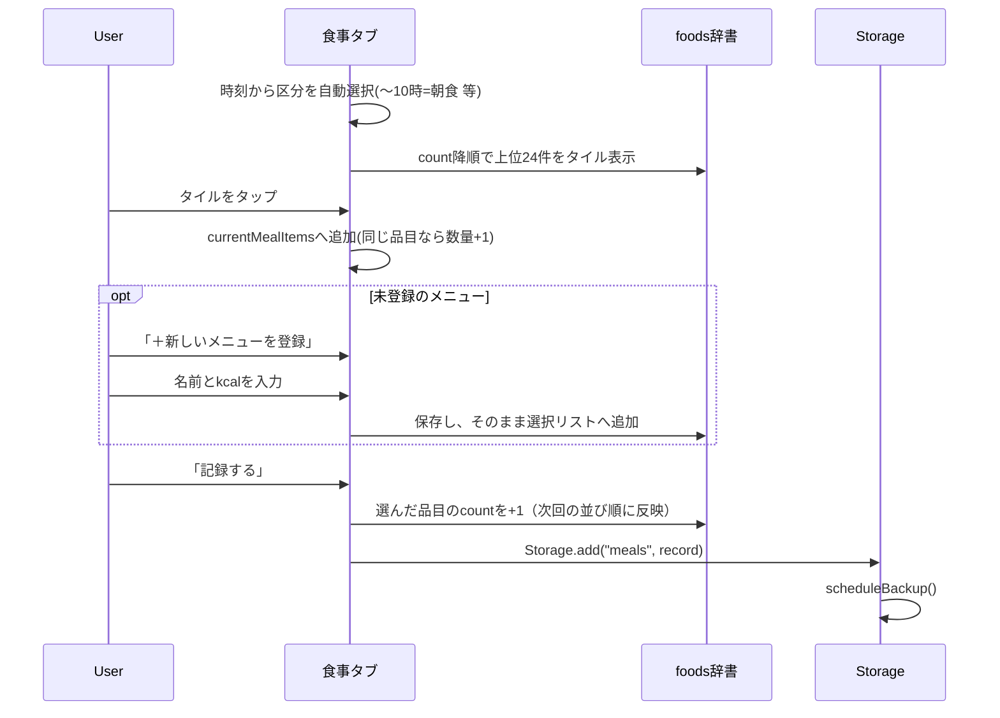
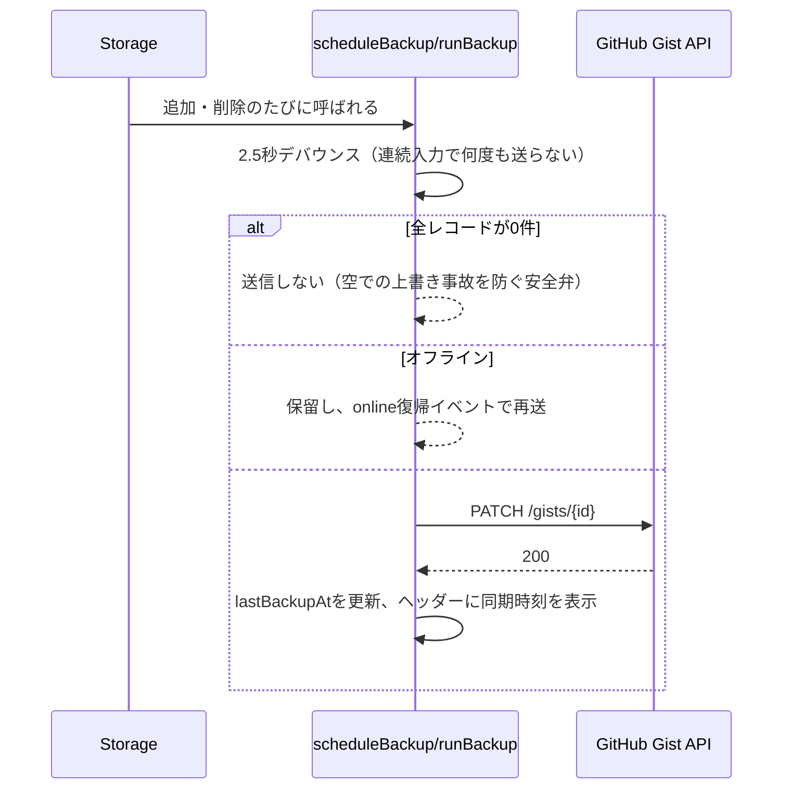
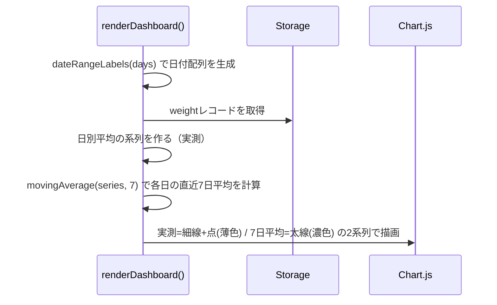

# 体重ノート（health-tracker）設計書

## 0. この改訂について

初版はPC向けの静的Webアプリだったが、**PCでの入力が続かない**という実運用上の問題により、
iPhoneでの入力を前提とした構成へ全面改訂した（v2.0.0）。

主要な設計変更は以下の4点。

| 変更 | 初版 | v2.0.0 |
|---|---|---|
| 想定端末 | PCブラウザ | iPhone（ホーム画面追加のPWA） |
| 目的 | 4カテゴリを網羅的に記録 | **減量・体重コントロールに特化** |
| 食事入力 | メニュー名を文字入力＋`window.prompt` | **タイルをタップして選ぶ**（文字入力は新規登録時のみ） |
| データ保全 | 手動エクスポートのみ | **private Gistへ自動バックアップ** |

## 1. 概要

| 項目 | 内容 |
|---|---|
| アプリ名 | 体重ノート (health-tracker) |
| 目的 | 減量のため、体重と摂取カロリーを毎日記録し、7日移動平均で増減トレンドを可視化する |
| 形態 | サーバーレスの静的Webアプリ（PWA）。GitHub Pagesで配信 |
| 主端末 | iPhone（Safariでホーム画面に追加して使用） |
| データ保存先 | iPhoneの `localStorage`（正本）＋ private Gist（バックアップ） |
| 外部依存 | Chart.js v4.4.4（**ローカル同梱**、CDN読込ではない） |

### 1.1 設計方針（なぜこうしたか）

- **入力1回あたりの手間を最小化する。** 「続かない」の原因は端末ではなく入力の摩擦であり、
  iPhoneに載せ替えるだけではフリック入力の分むしろ悪化する。よって食事入力は文字入力を排し、
  タップのみで完結させた。
- **毎日の必須入力は体重1項目に絞る。** 運動・睡眠・血圧は「その他」タブに退避し、
  ホーム画面に未記入欄が並ばないようにした。
- **バックアップは自動でなければ意味がない。** 手動バックアップは、
  それ自体が続かない作業なので習慣が途切れた時期にこそ実行されない。
- **体重は生データでは読めない。** 水分で日々±1kg動くため、7日移動平均を主線として描く。

## 2. システム構成



- バックエンド・データベースは存在しない。全ロジックはクライアントサイドJavaScriptで完結する。
- **データの正本はiPhoneのlocalStorage**。Gistはバックアップであり、PCからは書き込まない。
- Chart.jsは `vendor/chart.umd.min.js` としてリポジトリに同梱する。
  CDN依存を外したのは、電波の悪い場所（外食先・地下）でグラフが死ぬのを避けるため。

## 3. 画面構成

ヘッダー ＋ タブごとのパネル ＋ **下部固定タブバー** の1ページ構成。
タブバーを下に置いたのは、iPhoneで片手持ちのとき親指が届く位置がそこだから。



| 画面(タブ) | id | 内容 |
|---|---|---|
| ホーム | `tab-home` | 今日カード（体重・カロリーの記録状況）、目標カード（現在/目標/残り＋進捗バー）、体重グラフ（実測＋7日移動平均）、摂取カロリーグラフ（棒＋目標線）、折りたたみで運動・睡眠グラフ |
| 体重 | `tab-weight` | ±0.1kgステッパー付きの大きな数値入力＋一覧 |
| 食事 | `tab-meals` | 区分セグメント（時刻から自動選択）、メニュータイル、選択リスト、合計kcal＋一覧 |
| その他 | `tab-other` | 運動 / 睡眠・血圧 / 目標設定 / Gistバックアップ / ファイル入出力（すべて折りたたみ） |

### 3.1 ディープリンク

URLのハッシュでタブを直接開ける。iOSショートカットから「体重入力画面を直接開く」ために使う。

| URL | 動作 |
|---|---|
| `.../index.html#weight` | 体重タブを開き、入力欄にフォーカスする |
| `.../index.html#meals` | 食事タブを開く |
| `.../index.html?mode=view` | **閲覧専用モード**（PC用）。入力タブとタブバーを隠し、Gistから読んでグラフのみ表示 |

## 4. データモデル

localStorageキーは `healthTracker:` プレフィックス。

| localStorageキー | 内容 |
|---|---|
| `healthTracker:weight` | 体重レコード配列 |
| `healthTracker:meals` | 食事レコード配列 |
| `healthTracker:exercise` | 運動レコード配列 |
| `healthTracker:vitals` | 生活習慣レコード配列 |
| `healthTracker:foods` | 食品辞書（**v2で形式変更**） |
| `healthTracker:settings` | **v2で新規追加**。目標値とGist接続情報 |

### 4.1 レコード共通項目

全レコードは登録時に `id`（`{タイムスタンプ}-{ランダム文字列}`）が付与される。

**日付は端末のローカル日付を使う。** 初版は `toISOString()` を使っていたためUTCに変換され、
JSTの深夜0〜9時に記録すると前日の日付で保存される不具合があった。v2では
`getFullYear()/getMonth()/getDate()` から組み立てる `toDateStr()` に置き換えている。

### 4.2 カテゴリ別スキーマ

**weight（体重）**
| フィールド | 型 | 説明 |
|---|---|---|
| date | string(YYYY-MM-DD) | 記録日 |
| weight | number | 体重(kg) |
| memo | string | メモ（任意） |

**meals（食事）**
| フィールド | 型 | 説明 |
|---|---|---|
| date | string | 記録日 |
| mealType | string | 朝食/昼食/夕食/間食 |
| items | array<{name, qty, calories}> | 選んだ品目一覧 |
| content | string | 品目名を結合した表示用文字列、または品目未選択時はメモ |
| calories | number\|null | 合計カロリー（手動上書き優先、次点で自動合算） |
| memo | string | メモ（任意） |

**exercise（運動）** / **vitals（生活習慣）** … 初版から変更なし。

**foods（食品辞書）**

```jsonc
{ "カレーライス": { "kcal": 700, "count": 12 } }
```

`count` は選択回数。タイルは **count降順** で並ぶため、よく食べるものほど上に来て入力が速くなる。
初版の `{ "名前": kcal }`（数値）形式も読み込み時に自動変換される（`normalizeFoodDb`）。

**settings（設定）**
| フィールド | 型 | 説明 |
|---|---|---|
| targetWeight | number\|null | 目標体重(kg) |
| calorieTarget | number\|null | 1日の摂取カロリー目安(kcal) |
| gistToken | string | GitHubアクセストークン（`gist` スコープのみ） |
| gistId | string | バックアップ先GistのID |
| lastBackupAt | string(ISO) | 最終バックアップ日時 |

## 5. 機能一覧

| # | 機能 | 概要 |
|---|---|---|
| 1 | タブ切替・ディープリンク | 4タブの表示切替。`#weight` 等のハッシュで直接起動可能 |
| 2 | 体重の記録 | ±0.1kgステッパー、`inputmode="decimal"` で数値キーパッド、前回値をヒント表示 |
| 3 | 食事の記録（タップ式） | 区分は時刻から自動選択。メニュータイルをタップして積み上げ、量は `×0.5→1→1.5→2→3` を巡回 |
| 4 | 新規メニュー登録 | 名前とkcalをインラインフォームで登録（初版の `window.prompt` は廃止） |
| 5 | 運動・生活習慣の記録 | 「その他」タブ内の折りたたみに退避 |
| 6 | 記録の削除 | 一覧の「削除」ボタン。確認ダイアログあり |
| 7 | 減量ダッシュボード | 今日カード・目標カード・7日移動平均グラフ・カロリー目標線 |
| 8 | Gist自動バックアップ | 記録のたびに2.5秒デバウンスしてPATCH。**空データ時は送らない** |
| 9 | Gistから復元 | id重複を除いてマージ取り込み |
| 10 | 閲覧専用モード | `?mode=view` でPCからGistを読み、グラフのみ表示（書き込み一切なし） |
| 11 | エクスポート/インポート | JSONファイル。**v2から `foods` と `settings` も対象**（初版のバグ修正） |
| 12 | オフライン動作 | Service Workerで全アセットをキャッシュ。圏外でも起動・入力・グラフ表示が可能 |

## 6. 主要処理フロー

### 6.1 食事記録（タップ積み上げ方式）



### 6.2 Gistバックアップ



### 6.3 体重グラフ（7日移動平均）



## 7. 画面レイアウト・スタイル方針

- **モバイルファースト。** `main` は最大720pxだが、基準は390px幅（iPhone標準）。
- **入力欄のフォントサイズは16px固定。** iOS Safariは16px未満の入力欄にフォーカスすると
  自動ズームしてしまい、画面が飛ぶため。
- **safe-area対応。** ヘッダーは `env(safe-area-inset-top)`、タブバーは
  `env(safe-area-inset-bottom)` を確保し、ホームインジケータと重ならないようにする。
- タップ対象は最小44pxを確保する（`.btn { min-height: 44px }`）。
- CSS変数によるライト/ダークテーマ対応（`prefers-color-scheme`）。グラフの軸色も追随する。

## 8. 非機能要件・技術的特徴

| 観点 | 内容 |
|---|---|
| データ永続化 | iPhoneのlocalStorageが正本。Gistへ自動バックアップ |
| オフライン耐性 | Service Workerで全アセットをキャッシュ。圏外でも起動・入力可。Gistへの送信のみ復帰後に再試行 |
| セキュリティ | 一覧描画時に `escapeHtml` でエスケープしXSSを防止。Gistはprivate |
| 配信 | GitHub Pages（publicリポジトリ）。**配信されるのはHTML/JS/CSSのみで、健康データは一切含まれない** |
| 国際化 | 日本語UI固定、日付は `YYYY-MM-DD` 形式で統一 |

### 8.1 Service Workerの更新運用（重要）

`sw.js` の `CACHE_VERSION` を**変更のたびに必ず上げる**こと。
上げ忘れるとiPhone側に古い画面がキャッシュされたまま更新されない。

新バージョンを検知するとアプリ上部に「新しいバージョンがあります／更新」バーが出る。
押すと `SKIP_WAITING` → `controllerchange` → 自動リロードで切り替わる。

## 9. 既知の制約・今後の課題

- **iOSはWeb Push通知を出せない（実質）。** ホーム画面追加のWeb AppはiOS 16.4以降Web Pushに対応するが、
  送信にはVAPIDのプッシュサーバーが必要で、バックエンドを持たない本構成では実現できない。
  記録のリマインドはiOSショートカットのオートメーションで代替する（[SETUP.md](SETUP.md) 参照）。
- **Gistトークンは平文でlocalStorageに保存される。** `gist` スコープのみのトークンを使うことで
  被害範囲を「そのGistの読み書き」に限定しているが、ゼロリスクではない。
  iPhoneを紛失した場合はGitHub側でトークンを失効させること。
- **同期は一方向。** PCで入力した内容はiPhoneへ戻らない。PCは `?mode=view` の閲覧専用。
  双方向にする場合は削除を伝播させるための tombstone（削除フラグ）が必要になる。
- **iOSのストレージ削除リスクは残る。** Safariのタブで開いた場合、7日間未使用でlocalStorageが
  削除され得る。ホーム画面追加のWeb Appは保護が強いが絶対ではないため、Gistバックアップを
  必ず設定すること（設定しないとこのリスクが素通しになる）。
- カロリー辞書の値は「1人前の目安」であり、実際の摂取量とは誤差がある。
  減量トレンドを見る目的では十分だが、厳密な栄養管理には向かない。
